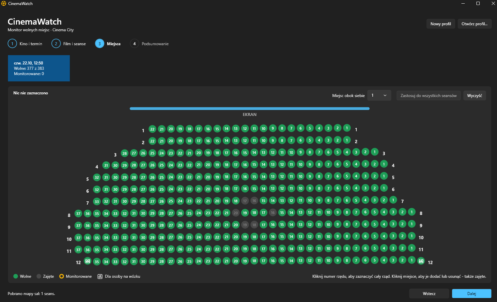
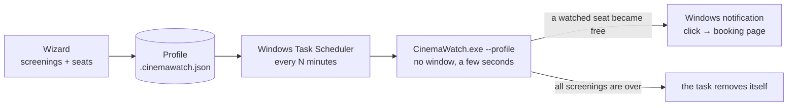

<p align="center">
  
</p>

<h1 align="center">CinemaWatch</h1>

<p align="center">
  Get notified when a seat you want frees up for a sold-out Cinema City screening.
</p>

<p align="center">
  <a href="https://github.com/damiankowalski/CinemaWatch/actions/workflows/ci.yml"></a>
  <a href="https://github.com/damiankowalski/CinemaWatch/releases/latest"></a>
  
  
  <a href="LICENSE"></a>
</p>

<p align="center">
  
</p>

---

## What it is

Popular IMAX screenings sell out weeks in advance - but seats keep coming back as unpaid reservations expire
and tickets are returned. Catching them means refreshing the seat map over and over.

**CinemaWatch** does the refreshing for you. You pick the screenings and mark the rows or seats you would
actually buy, and the app checks them in the background. When one of them becomes free, you get a Windows
notification - one click takes you straight to the booking page.

It is a small Windows desktop app (WPF, .NET 10) with a Polish and English user interface. For now it supports
**Cinema City Sadyba (Warsaw), IMAX**, subtitled screenings.

> Na skrócie po polsku: CinemaWatch monitoruje wybrane miejsca na wyprzedane seanse IMAX w Cinema City Sadyba
> i pokazuje powiadomienie Windows, gdy któreś się zwolni. Kliknięcie otwiera stronę zakupu biletu.

## Features

- **Guided wizard** - date or date range → film and screenings → hall map → summary.
- **Interactive hall map** drawn from the cinema's own seat plan, with live occupancy.
  - Click a row number to watch the whole row, click seats to add or remove them - taken seats too.
  - Wheelchair spaces are shown separately and never counted as regular free seats.
  - Optional condition: notify only when *N* watched seats are free next to each other.
  - Copy a selection to every screening in the same hall with one click.
- **Profiles** - save your setup to a readable `.cinemawatch.json` file, reopen it later (with fresh data)
  or check it on demand.
- **Background checks** through Windows Task Scheduler - no app running in the background, no window.
- **Smart notifications** - only for seats that became free since the last check; clicking opens the booking page.
- **Cleans up after itself** - a scheduled task removes itself after the last screening of its profile.
- **Polish and English** - follows the Windows display language, switchable at any time (top-right corner).
- Light and dark mode (Windows 11 Fluent design).

CinemaWatch only *reads* public seat information. It never logs in, never creates a cart and never reserves or
buys anything - buying stays with you.

## How it works



1. The wizard loads the repertoire, the hall layout and the current occupancy from Cinema City.
2. Your selection is saved as a profile.
3. *Add to Task Scheduler* creates a task (after your confirmation) that runs
   `CinemaWatch.exe --profile "<file>"` every 5-60 minutes while you are logged on.
4. Each run checks the watched seats once, shows a notification for newly freed ones and exits.

## Download and install

1. Download `CinemaWatch.exe` from the [latest release](https://github.com/damiankowalski/CinemaWatch/releases/latest).
2. Put it in a permanent folder, e.g. `C:\Tools\CinemaWatch\` - scheduled tasks point to this exact path.
3. Run it. No installation and no .NET runtime are needed (single self-contained file, Windows 10 1809+ / 11, x64).

The exe is not code-signed, so Windows SmartScreen may show a warning on first start:
*More info* → *Run anyway*. Each release includes a `.sha256` file to verify the download.

## Usage

1. **Cinema and dates** (*Kino i termin*) - choose a date or a date range (up to 31 days).
2. **Film and screenings** (*Film i seanse*) - pick the film and tick the screenings. Sold-out ones can be ticked
   too - those are the ones worth watching.
3. **Seats** (*Miejsca*) - mark rows and seats on the hall map of each screening.
4. **Summary** (*Podsumowanie*) - *Check now* checks immediately; save the profile and *Add to Task Scheduler*
   to keep watching in the background.

### Stopping and cleaning up

- Open the profile → *Remove from Task Scheduler* (*Usuń z Harmonogramu*). From then on there are no notifications.
- After the last screening the task removes itself; opening an outdated profile also offers to remove its task.
- Without the app: `schtasks /Delete /TN "\CinemaWatch\<profile name>" /F`.
- All data written by the app lives in `%LOCALAPPDATA%\CinemaWatch` (safe to delete) plus your profile files.

### Command line

```powershell
CinemaWatch.exe                                          # wizard
CinemaWatch.exe --profile "C:\path\name.cinemawatch.json" # one background check
```

Exit codes of `--profile`: `0` checked, `1` profile could not be read, `2` every screening failed, `3` unexpected error.
Each run is logged to `%LOCALAPPDATA%\CinemaWatch\Logs\cinemawatch.log`.

| Data | Location |
| --- | --- |
| Settings (language) | `%LOCALAPPDATA%\CinemaWatch\settings.json` |
| Profiles | `Profiles\` next to the exe (if writable), otherwise `%LOCALAPPDATA%\CinemaWatch\Profiles` - or anywhere you choose |
| Notification state | `%LOCALAPPDATA%\CinemaWatch\State\` |
| Hall layout cache | `%LOCALAPPDATA%\CinemaWatch\Cache\` (refreshed weekly) |
| Log | `%LOCALAPPDATA%\CinemaWatch\Logs\cinemawatch.log` |

## Responsible use

CinemaWatch uses the same public endpoints the Cinema City website calls when you open a seat map, at a low rate:
one check costs **two small requests per watched screening** (the hall layout is cached for a week).
Watching four screenings every 10 minutes is under one request per minute, and each check transfers less data
than opening the seat map once in a browser.

Please keep it that way: use intervals of 10 minutes or more, watch only screenings you would really buy and
remove profiles you no longer need. This is an unofficial API that may change at any time, and the project is
**not affiliated with Cinema City**.

## Building from source

Requirements: Windows 10/11 and the [.NET 10 SDK](https://dotnet.microsoft.com/download)
(`winget install Microsoft.DotNet.SDK.10`). Visual Studio is not required.

```powershell
dotnet run --project tests\CinemaWatch.Tests   # run all tests (no test packages needed)
dotnet run --project src\CinemaWatch.App       # start the app
.\publish.ps1 -Version 1.0.0                   # single-file exe + checksum in .\artifacts
```

Releases are built by GitHub Actions: pushing a tag such as `v1.0.1` runs the tests, publishes the exe and
creates the release.

### Project structure

| Path | Contents |
| --- | --- |
| `src/CinemaWatch.Core` | Cinema City API client, parsing, seat matching, profiles, notifications, Task Scheduler, background runner |
| `src/CinemaWatch.ViewModels` | Wizard view models without WPF references (fully testable) |
| `src/CinemaWatch.App` | WPF app: views, hall map, Windows notifications, dialogs |
| `tests/CinemaWatch.Tests` | Dependency-free tests using captured API responses |
| `scripts/CinemaWatch.ps1` | Standalone PowerShell monitor with e-mail notifications (the project's origin) |

### Cinema City endpoints

| Purpose | Endpoint |
| --- | --- |
| Repertoire of a day | `GET www.cinema-city.pl/pl/data-api-service/v1/quickbook/10103/film-events/in-cinema/{cinemaId}/at-date/{date}` |
| Screening details | `GET tickets.cinema-city.pl/api/presentations/{id}` |
| Hall layout | `POST tickets.cinema-city.pl/api/seats/seatplanV2?venueId=&seatplanId=` |
| Free seats | `GET tickets.cinema-city.pl/api/seats/seats-statusV2?presentationId=&venueTypeId=&isReserved=` |

The seat status lists only free seats (keys `{section}_{position}_{row}`); consecutive positions in a row are
physically adjacent. Wheelchair spaces are flagged in the layout and reported separately.

## Roadmap

- Choice of city, cinema and technology (2D, 3D, 4DX, IMAX) - the data model is ready for it.
- More cinemas from the Cinema City network.

## License

[MIT](LICENSE) © 2026 Damian Kowalski
