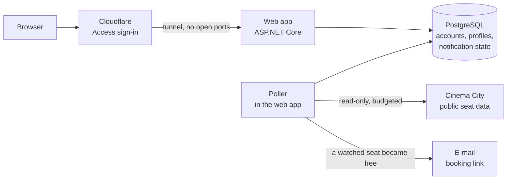

  

<h1 align="center">CinemaWatch Web</h1>

  The CinemaWatch seat monitor as a private web service: the same wizard and hall map as the desktop app, with checks
  running on a server and notifications by e-mail.

  
  
  
  
  

---

## What it is

The [desktop app](../README.md) watches seats from your own Windows PC, so your PC has to be on. **CinemaWatch Web**
runs the same checks on a server around the clock and sends an e-mail with the booking link when a watched seat
frees up. You can use it from any browser, a phone included.

It is a **private service for the owner and a few invited friends**, not a public product: there is no sign-up form,
accounts exist only by the owner's invitation, and every page sits behind two separate sign-ins. It is free and not
commercial.

> Po polsku w skrócie: CinemaWatch Web to prywatna, internetowa wersja CinemaWatch dla właściciela i kilku
> zaproszonych osób. Ten sam kreator i mapa sali co w aplikacji desktopowej, sprawdzanie na serwerze przez całą dobę
> i powiadomienie e-mailem z linkiem do zakupu. Bez rejestracji - konta tylko z zaproszenia.

## Features

- **The desktop wizard in the browser** - city and dates → film and screenings → hall map → summary, with the same
  date ranges, the same suggested profile name and the same clickable steps.
- **Interactive hall map** drawn with the same geometry as the desktop map: click seats or a row number, *paint* by
  dragging from a seat, draw a *rectangle* from an empty spot, Esc cancels; copy a selection to screenings in the same
  hall; optional "N free seats next to each other". With a finger a tap toggles one seat. The map also works without
  JavaScript.
- **Profiles from both worlds** - create them in the wizard or import `.cinemawatch.json` files saved by the desktop
  app; a profile made on the site downloads and opens in the desktop app too. *Edit* reopens any profile in the
  wizard and keeps what has already been reported.
- **Background checks on the server** - each watched screening is checked every 10 minutes or more, once for every
  profile that watches it; *Check now* checks a profile on demand.
- **E-mail notifications** - only for seats that became free since the last check, one line per screening with its
  booking link; a history of what was sent.
- **Your data in your hands** - download your data, delete your account, Polish and English, light and dark mode.
- **Operator's panel** for the owner: the state of every component, the request log against the budget, events, a
  pause switch and the settings, without redeploying.

Like the desktop app, CinemaWatch Web only *reads* public seat information. It never logs in to Cinema City, never
creates a cart and never reserves or buys anything.

## Screenshots

<!-- Screenshots of the four wizard steps go here once they are in docs/images:
<table>
  <tr>
    <td width="50%"></td>
    <td width="50%"></td>
  </tr>
  <tr>
    <td align="center"><b>1. City and dates</b></td>
    <td align="center"><b>2. Film and screenings</b></td>
  </tr>
  <tr>
    <td width="50%"></td>
    <td width="50%"></td>
  </tr>
  <tr>
    <td align="center"><b>3. Seats</b></td>
    <td align="center"><b>4. Summary</b></td>
  </tr>
</table>
-->

*Screenshots of the four wizard steps are coming.* Until then, the [desktop screenshots](../README.md#screenshots)
show the same steps.

## How it works

1. You create a profile in the wizard (or import one from the desktop app). The wizard's Cinema City data comes from
   a cache shared by all accounts, so the same repertoire is fetched once.
2. The poller keeps one list of the screenings all profiles watch and checks each of them on its own schedule.
3. When a watched seat frees up, the profile's owner gets one e-mail with the booking links.
4. After the last screening of a profile it simply stops being checked.

## Responsible use

The service talks to Cinema City the way the desktop app does: the same public endpoints, two small requests per
check, the hall layout cached for a week. On top of that it keeps **hard limits** that no user can exceed: a
budget of requests per hour for the background checks, a separate one for the wizard, a limit per account, one
request at a time with pauses in between, and an automatic pause of up to 24 hours at the first sign of a block.
Nothing is ever queued past a block, and the owner can pause everything with one switch.

The project is **not affiliated with Cinema City**; the API is unofficial and may change at any time.

## Security and privacy

- **Two gates:** Cloudflare Access (a one-time code by e-mail) in front of the whole site, then the app's own
  sign-in; the owner's pages have a third, owner-only Access gate.
- **No open ports:** the server reaches Cloudflare through an outbound tunnel; the host firewall lets in SSH only,
  and the server's address is not published.
- **A visitor without an account can cause no cost and no damage:** the public pages write nothing to the database,
  send nothing to Cinema City and only a limited number of e-mails, and never tell whether an address has an account.
- **Data in the EU:** the server in Warsaw (OVHcloud), e-mail through Resend (Ireland), encrypted daily backups in
  Backblaze B2 (EU Central). No ads, no analytics, only essential cookies; pages are marked `noindex`.
- The privacy notice inside the app lists every service and what it stores.

## Technology

| Part | Choice |
| --- | --- |
| App | .NET 10, ASP.NET Core, Blazor with static server-side rendering (plain HTML forms) and one small script for the hall map |
| Shared logic | `CinemaWatch.Core` - the same Cinema City client, seat rules and hall geometry as the desktop app |
| Database | PostgreSQL 18, EF Core migrations applied at start-up |
| Hosting | One VPS (Ubuntu 26.04), Docker Compose: the app, PostgreSQL and `cloudflared` |
| Edge | Cloudflare (DNS, Tunnel, Access) |
| Images and CI | GitHub Actions; the container image is published to GitHub Container Registry on `web-v*` tags |
| Monitoring and backups | Healthchecks.io (heartbeat and backup checks); `pg_dump` encrypted with `age` to Backblaze B2 |

## Status

| Version | What it brought |
| --- | --- |
| 0.7.0 (Nov 2026) | The wizard and the hall map on the site; editing any profile |
| 0.6.0 (Nov 2026) | Hardened public pages, account deletion by the owner |
| 0.5.x (Nov 2026) | The container image, the first deployment to the server, backups |
| MVP 0 (Nov 2026) | Accounts by invitation, desktop profile import, background checks, e-mail notifications |

Next: Android (planned). The full plan and every decision are in [`SAAS.md`](SAAS.md).

## Documentation

| Document | For |
| --- | --- |
| [`src/CinemaWatch.Web/README.md`](../src/CinemaWatch.Web/README.md) | Developers: how the app behaves in detail, configuration, local development, tests |
| [`SAAS.md`](SAAS.md) | The plan, the architecture, the decision log |
| [`SAAS_INFRA.md`](SAAS_INFRA.md) | The server side: containers, tunnel, Access, e-mail, backups, runbooks |
| [`KNOWLEDGE_BASE.md`](KNOWLEDGE_BASE.md) | The Cinema City API and the profile format shared with the desktop app |

## License

[PolyForm Noncommercial 1.0.0](../LICENSE) © 2026 Damian Kowalski: free for noncommercial use; any commercial use
needs the author's written permission. Versions before 14 November 2026 were released under MIT (see the
[README](../README.md#license)).
